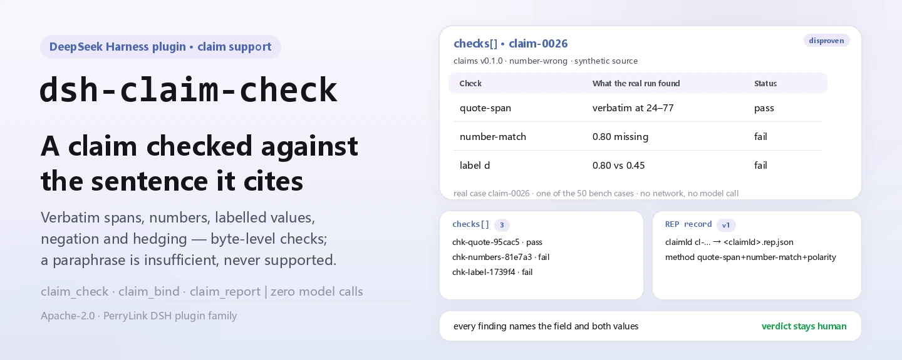
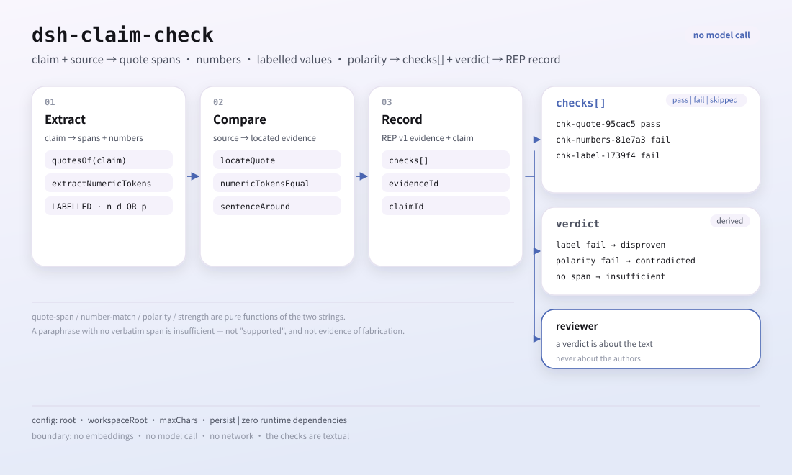
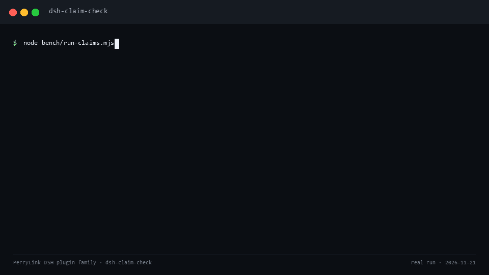

<div align="center">

<picture>
  <source media="(prefers-color-scheme: dark)" srcset="docs/assets/dsh-claim-check-hero-en-dark.webp">
  
</picture>

# dsh-claim-check

**¿La fuente respalda realmente la afirmación tal como está escrita?**

*A nivel de bytes, determinista y recomputable: fragmentos literales, números, valores etiquetados, negación y matización. Una paráfrasis se reporta como `insufficient` — nunca como "respaldada".*

[English](README.md) · [简体中文](README-zh.md) · [Español](README-es.md) · [Português](README-pt.md) · [हिन्दी](README-hi.md)

[](LICENSE)
[]()

</div>

---

## Qué hace

- **Comprobación de fragmento literal** — cada fragmento citado en la afirmación debe aparecer en la fuente (normalizando espacios y Unicode).
- **Comprobación de números** — cada literal numérico de la afirmación debe aparecer en la fuente, con tolerancia de formato (`2.50` = `2.5`).
- **Comprobación de valores etiquetados** — cuando la afirmación dice `d = 0.80` y la fuente dice `d = 0.45`, la afirmación es `disproven` y se muestran ambos valores. Esto es lo que convierte "falta un número" en una contradicción real.
- **Comprobación de polaridad** — una afirmación en forma afirmativa construida sobre un fragmento de una oración negada ("**not** significant") es `contradicted`.
- **Comprobación de fuerza** — una oración matizada o asociativa ("may be associated", "preliminary") vendida como causal ("proves", "demonstrates") es `contradicted`.
- **Integración REP** — instantánea de la fuente + afirmación + veredicto + comprobaciones forman un registro válido; `claim_bind` comprueba contra evidencia ya almacenada por `doc_anchor` / `cite_verify`.


<picture>
  <source media="(prefers-color-scheme: dark)" srcset="docs/assets/dsh-claim-check-flow-v5-dark.svg">
  
</picture>

*Estructura: extraer → comparar → registrar; `checks[]` y `verdict` son las dos salidas, y una paráfrasis sin fragmento literal es `insufficient` en lugar de "respaldada". Las etiquetas de token dentro del diagrama son los nombres reales de las herramientas y de las comprobaciones, así que la misma imagen sirve para los cinco idiomas.*

## Qué no hace

- **Sin semántica.** Una paráfrasis sin fragmento literal es `insufficient`, no "respaldada". Es un límite deliberado, no un fallo.
- **Sin reanálisis de datos.** No comprueba si el estadístico subyacente es correcto — eso es `dsh-statcheck`.
- **Sin lectura de PDF.** Extrae el texto primero (`dsh-doc-anchor`).
- **Sin acusaciones de mala conducta.** Un veredicto habla del texto, nunca de los autores.
- **Sin llamada a un modelo.** Cada hallazgo es recomputable a partir de las dos cadenas.

## Semántica de los veredictos

| Veredicto | Significado |
|---|---|
| `verified` | se localizó un fragmento literal **y** los números coinciden (y no hay contradicción de polaridad/fuerza) |
| `disproven` | el fragmento citado está ausente, o un valor etiquetado contradice la fuente |
| `contradicted` | se invirtió la negación o la matización de la oración citada |
| `insufficient` | no hay fragmento literal (paráfrasis), o falta un número, o la fuente no dice nada |
| `unverified` | reservado por REP v1 para una afirmación sin contenido comprobable; v0.1 reporta esa paráfrasis como `insufficient` |

`insufficient` nunca significa falso, y nunca significa "limpio".

## Herramientas

### `claim_check`

`{ claim, text? | path?, quote?, persist? }` → `{ ok, verdict, checks[], quotes[], labels[], evidenceId?, claimId?, recordPath? }`.

### `claim_bind`

`{ claim, evidenceId, quote?, persist? }` — lee la instantánea textual de la evidencia desde el almacén REP y escribe allí la afirmación + el veredicto.

### `claim_report`

`{ claim, verdict, checks }` → `{ ok, markdown, sarif }`. Las comprobaciones fallidas o con advertencia se convierten en resultados SARIF.

### Códigos de error

`INVALID_INPUT` · `NOT_FOUND` · `PATH_ESCAPE` · `NOT_A_FILE` · `TOO_LARGE` · `EVIDENCE_UNKNOWN` · `STORE_ERROR`

## Compatibilidad e instalación

| | |
|---|---|
| DeepSeek Harness | **`dsh-v0.2.2-rc.4`** (verificado el 2026-11-18); peer `>=0.2.1-0 <0.3.0 \|\| >=0.2.2-0 <0.3.0` |
| Node | `^22.19.0 \|\| >=24.9.0` (probado en `24.22.1`), solo ESM |
| Peers | `@perrylink/dsh-research-core ^0.1.0`, `@deepseek-ai/cordis ^4.0.5-alpha.1`, `@deepseek-ai/dsh-tools`, `@deepseek-ai/schemastery ^3.18.5-alpha.1` |
| Dependencias de runtime | **cero** |

```sh
dsh plugin --profile <name> add @perrylink/dsh-research-core @perrylink/dsh-claim-check
dsh --profile <name> --dump-config | grep @perrylink/dsh-claim-check
```

## Configuración

| Clave | Predeterminado | Significado |
|---|---|---|
| `enabled` | `true` | `false` no monta nada |
| `root` | `.claim-check` | raíz del almacén y de los registros |
| `workspaceRoot` | `process.cwd()` | las rutas de las fuentes deben resolverse dentro de ella |
| `maxChars` | `2000000` | límite de caracteres de la fuente (falla, nunca trunca) |
| `persist` | `true` | almacena evidencia + afirmación + registro |

## Evaluación



*Animado: `node bench/run-claims.mjs` sobre el conjunto congelado `dsh-research-bench` claims v0.1.0 (el checkout de bench hermano se indica con `BENCH_DIR`; sin red, sin llamada a un modelo; reejecutado el 2026-11-21). Son cifras de línea base de regresión, no una estimación insesgada — la sección del conjunto retenido de abajo reporta 0.96.*


### Base de regresión — `dsh-research-bench` claims v0.1.0 (50 casos)

```sh
pnpm run bench:claims
```

| métrica | valor |
|---|---:|
| exactitud del veredicto | **1.00** |
| precision / recall de verified | **1.00 / 1.00** |
| precision / recall de insufficient | **1.00 / 1.00** |
| precision / recall de contradicted | **1.00 / 1.00** |
| precision / recall de disproven | **1.00 / 1.00** |
| tasa de sobreafirmación (no respaldado llamado verified) | **0.00** |
| tasa de falsas alarmas en afirmaciones respaldadas | **0.00** |

Predicciones por caso en crudo: [`bench/results-claims.json`](bench/results-claims.json).

**Advertencia de validez (léela antes de citar las cifras).** Los 50 casos y las reglas del detector se escribieron juntos a partir de la misma rúbrica, y la regla de polaridad se estrechó después de que un caso respaldado fallara durante el desarrollo. Estas cifras son una **línea base de regresión, no una estimación insesgada** de la exactitud sobre manuscritos reales. El conjunto retenido de abajo es el siguiente paso; es un hold-out temporal del mismo autor, no una auditoría externa totalmente ciega.

### Conjunto retenido — `dsh-research-bench` claims-heldout v0.1.0 (50 casos, congelados el 2026-11-08)

```sh
pnpm run bench:claims-holdout
```

Los 50 casos viven en el árbol de trabajo hermano `dsh-research-bench`, en `data/claims-heldout/` (siete fuentes sintéticas, cuatro oraciones cada una), y se congelaron antes de la primera ejecución de evaluación. `SUMMARY.json` registra `heldOut: true`, `frozenAt: "2026-11-08"` y `sha256:016eaa67ba12ec1b3022e68dbc627b414c43733551fdd457b70dd1907e81d470`. El runner vuelve a calcular el hash de `cases.jsonl` en cada ejecución y se niega a puntuar si el hash congelado ya no coincide; ninguna etiqueta se cambió después de la congelación.

| métrica | línea base de regresión | conjunto retenido |
|---|---:|---:|
| exactitud del veredicto | 1.00 | **0.96** (48/50) |
| precision / recall de verified | 1.00 / 1.00 | **0.88 / 1.00** |
| precision / recall de insufficient | 1.00 / 1.00 | **1.00 / 1.00** |
| precision / recall de contradicted | 1.00 / 1.00 | **1.00 / 0.83** |
| precision / recall de disproven | 1.00 / 1.00 | **1.00 / 1.00** |
| tasa de sobreafirmación (no respaldado llamado verified) | 0.00 | **0.06** (2/35) |
| tasa de falsas alarmas en afirmaciones respaldadas | 0.00 | **0.00** |

Exactitud por categoría: supported 15/15, paraphrase 10/10, number-wrong 8/8, negated 6/7, quote-mined 4/5, insufficient 5/5.

Predicciones por caso en crudo: [`bench/results-claims-holdout.json`](bench/results-claims-holdout.json); markdown: [`bench/results-claims-holdout.md`](bench/results-claims-holdout.md).

**Los dos fallos son sobreafirmaciones, y ambos son huecos de cobertura de la lista de señales.** La localización de citas, la coincidencia de números y la contradicción de valores etiquetados fueron perfectas en este conjunto; los errores son señales semánticas que las listas léxicas no conocen:

1. `claim-0034` (negated; se esperaba `contradicted`, se predijo `verified`). La fuente dice "The coating failed to improve rate capability..." y la afirmación solo cita "improve rate capability at 4.2 V". "Failed to" es una negación semántica, pero las señales de negación de v0.1 son `not` / `no` / `never` / ... y no la incluyen, así que la comprobación de polaridad nunca se ejecuta. Arreglo candidato: añadir `fail(?:ed|s)? to`, `unable to` y `declined to` a la lista de señales, con pruebas de regresión.
2. `claim-0045` (quote-mined; se esperaba `contradicted`, se predijo `verified`). La fuente dice "Cooling seems tied to canopy density..." y la afirmación dice que "prueba" un efecto causal. "Seems tied to" es asociativo/matizado, pero las señales de matización de v0.1 no lo incluyen, así que la comprobación de fuerza nunca se ejecuta. Arreglo candidato: añadir `seem(?:s|ed)?`, `appear(?:s|ed)?`, `tied to`, `linked to`, `tentative` y `exploratory` a las señales de matización, con pruebas.

Estos son exactamente los casos que una línea base de regresión no puede exponer: el mismo autor escribió los casos de la base junto con las listas de señales.

**Independencia (honesta).** El conjunto retenido **no es una auditoría externa totalmente ciega**. Lo escribió el mismo autor de la rúbrica que la línea base de regresión, a partir de `rubric/CLAIMS.md`, y sigue las mismas convenciones de construcción (fragmentos explícitos entre comillas dobles, un fragmento citado por afirmación, párrafos sintéticos en inglés). Lo independiente es el contenido: siete temas nuevos, oraciones nuevas, números nuevos, y ningún párrafo de origen ni afirmación reutilizados de `data/claims`; las etiquetas se fijaron y se hashearon antes de la primera ejecución de evaluación, y ninguna etiqueta se cambió después. Es un hold-out temporal y una prueba de cobertura de la lista de señales, no una estimación insesgada de la exactitud sobre manuscritos reales: el conjunto es sintético y pequeño (5–15 casos por categoría). El conjunto de datos permanece por ahora en el árbol de trabajo hermano de bench; este repositorio versiona el runner y los resultados congelados, no los casos.

### Pruebas

**26 pruebas** en tres archivos: evaluator (extracción de citas incl. posesivos, offsets exactos cuando el primer token se repite, localización de la oración, verified / paráfrasis / cita ausente / contradicción de valor etiquetado / inversión de negación / sobreafirmación matizada / exactitud de resultado nulo / citas de intervalo / número ausente / contenido ausente), runtime/tools (validez del registro REP, rechequeo sin conflicto de evidencia, persist=false, escape de ruta, bind a la evidencia almacenada y a su instantánea textual en lugar de la primera instantánea; esquemas, renderizadores, rama de fallo, contrato del paquete), mount (el contrato de montaje habilitado/deshabilitado).

## Limitaciones conocidas (v0.1)

- La cita indirecta, los marcadores de cita y las búsquedas en tablas no se analizan.
- La detección de matización es léxica (una lista fija de señales), así que una afirmación causal que evite esos verbos puede pasar.
- Un *intervalo* citado o un tamaño de muestra no llevan dirección, así que la polaridad solo se comprueba en fragmentos direccionales.
- Las afirmaciones en otros idiomas se soportan estructuralmente, pero las listas de señales son solo en inglés.
- La ejecución retenida encontró dos huecos concretos de señales: `failed to` (negación semántica) y `seems tied to` (matización); ambos se documentan en la sección del conjunto retenido de arriba.

## Licencia

Apache-2.0. Sin código de terceros en runtime.
