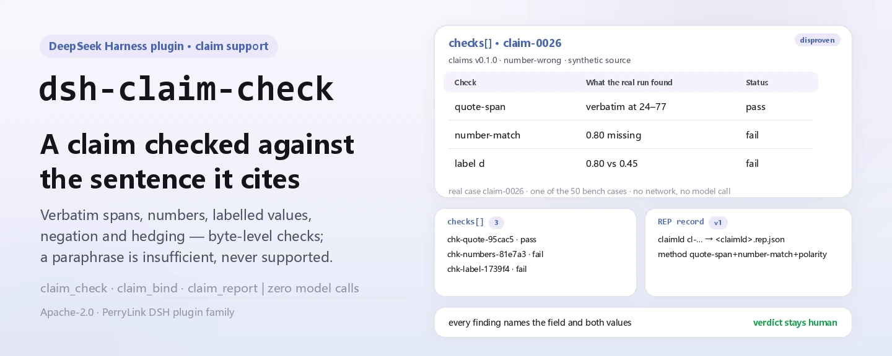
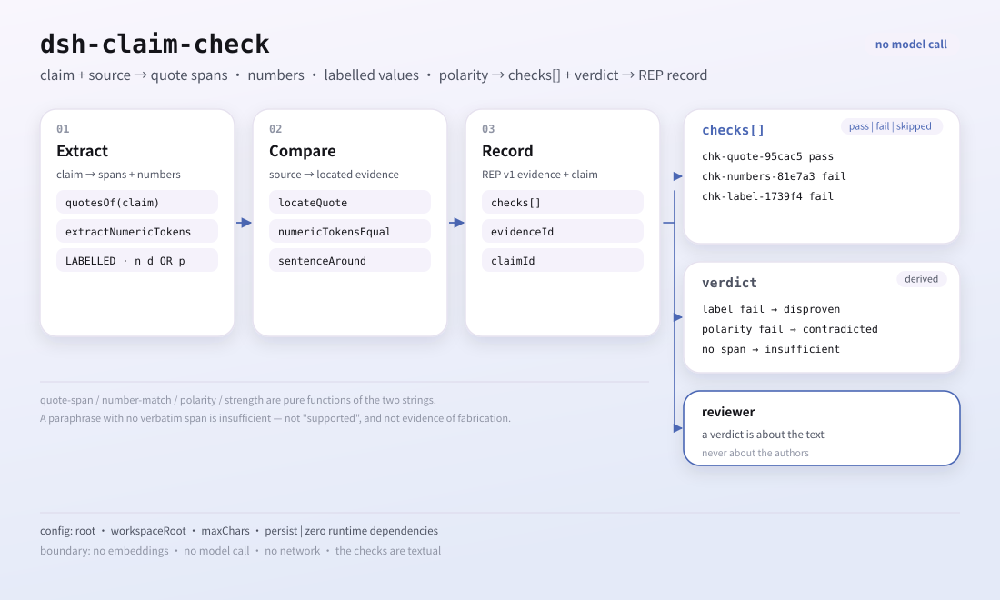
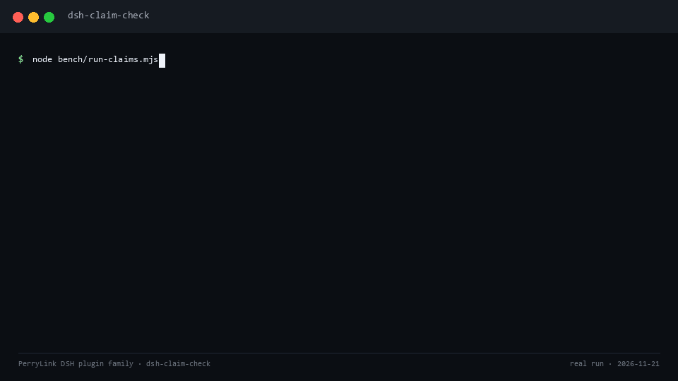

<div align="center">

<picture>
  <source media="(prefers-color-scheme: dark)" srcset="docs/assets/dsh-claim-check-hero-en-dark.webp">
  
</picture>

# dsh-claim-check

**क्या स्रोत वास्तव में लिखे गए दावे का समर्थन करता है?**

*बाइट-स्तर, नियतात्मक, पुनर्गणनीय: शब्दशः अंश, संख्याएँ, लेबल किए गए मान, निषेध और हेजिंग। पैराफ़्रेज़ को `insufficient` के रूप में रिपोर्ट किया जाता है — कभी "समर्थित" के रूप में नहीं।*

[English](README.md) · [简体中文](README-zh.md) · [Español](README-es.md) · [Português](README-pt.md) · [हिन्दी](README-hi.md)

[](LICENSE)
[]()

</div>

---

## यह क्या करता है

- **शब्दशः अंश जाँच** — दावे का हर उद्धृत अंश स्रोत में मौजूद होना चाहिए (स्पेस और Unicode सामान्यीकृत)।
- **संख्या जाँच** — दावे का हर संख्यात्मक लिटरल स्रोत में मौजूद होना चाहिए, फ़ॉर्मैटिंग सहनशीलता के साथ (`2.50` = `2.5`)।
- **लेबल किए गए मान की जाँच** — जब दावा `d = 0.80` कहता है और स्रोत `d = 0.45` कहता है, तो दावा `disproven` होता है और दोनों मान दिखाए जाते हैं। यही "एक संख्या गायब है" को असली विरोधाभास बनाता है।
- **ध्रुवता (polarity) जाँच** — निषेधित वाक्य के किसी अंश पर खड़ा सकारात्मक दावा ("**not** significant") `contradicted` होता है।
- **तीव्रता (strength) जाँच** — हेज्ड या सहसंबंध-सूचक वाक्य ("may be associated", "preliminary") को कारण-निष्कर्ष ("proves", "demonstrates") के रूप में बेचना `contradicted` होता है।
- **REP एकीकरण** — स्रोत स्नैपशॉट + दावा + निर्णय + जाँचें एक वैध रिकॉर्ड बनाते हैं; `claim_bind` उस एविडेंस के विरुद्ध जाँचता है जो `doc_anchor` / `cite_verify` पहले से संग्रहीत कर चुके हैं।


<picture>
  <source media="(prefers-color-scheme: dark)" srcset="docs/assets/dsh-claim-check-flow-v5-dark.svg">
  
</picture>

*संरचना: निकालना → तुलना करना → दर्ज करना; `checks[]` और `verdict` दो आउटपुट हैं, और बिना शब्दशः अंश वाला पैराफ़्रेज़ "समर्थित" के बजाय `insufficient` है। डायग्राम के अंदर टोकन लेबल असली टूल और जाँचों के नाम हैं, इसलिए एक ही चित्र पाँचों भाषाओं के लिए काम आता है।*

## यह क्या नहीं करता

- **कोई अर्थ-विश्लेषण नहीं।** बिना शब्दशः अंश वाला पैराफ़्रेज़ `insufficient` है, "समर्थित" नहीं। यह जानबूझकर रखी गई सीमा है, बग नहीं।
- **डेटा का पुनर्विश्लेषण नहीं।** यह नहीं जाँचता कि अंतर्निहित आँकड़ा सही है या नहीं — वह `dsh-statcheck` का काम है।
- **PDF पढ़ना नहीं।** पहले पाठ निकालें (`dsh-doc-anchor`)।
- **कदाचार के आरोप नहीं।** निर्णय पाठ के बारे में होता है, कभी लेखकों के बारे में नहीं।
- **मॉडल कॉल नहीं।** हर निष्कर्ष दो स्ट्रिंग्स से पुनर्गणनीय है।

## निर्णयों का अर्थ

| निर्णय | अर्थ |
|---|---|
| `verified` | एक शब्दशः अंश मिला **और** संख्याएँ मेल खाती हैं (और ध्रुवता/तीव्रता का कोई विरोधाभास नहीं) |
| `disproven` | उद्धृत अंश अनुपस्थित है, या कोई लेबल किया गया मान स्रोत का खंडन करता है |
| `contradicted` | उद्धृत वाक्य का निषेध या हेजिंग उलट दिया गया है |
| `insufficient` | कोई शब्दशः अंश नहीं (पैराफ़्रेज़), या संख्या गायब है, या स्रोत कुछ नहीं कहता |
| `unverified` | REP v1 में बिना जाँचने योग्य सामग्री वाले दावे के लिए आरक्षित; v0.1 ऐसे पैराफ़्रेज़ को `insufficient` रिपोर्ट करता है |

`insufficient` का अर्थ कभी "झूठा" नहीं, और कभी "साफ़" नहीं।

## टूल

### `claim_check`

`{ claim, text? | path?, quote?, persist? }` → `{ ok, verdict, checks[], quotes[], labels[], evidenceId?, claimId?, recordPath? }`.

### `claim_bind`

`{ claim, evidenceId, quote?, persist? }` — REP स्टोर से एविडेंस का टेक्स्ट स्नैपशॉट पढ़ता है और वहीं दावा + निर्णय लिखता है।

### `claim_report`

`{ claim, verdict, checks }` → `{ ok, markdown, sarif }`. विफल/चेतावनी वाली जाँचें SARIF परिणाम बनती हैं।

### त्रुटि कोड

`INVALID_INPUT` · `NOT_FOUND` · `PATH_ESCAPE` · `NOT_A_FILE` · `TOO_LARGE` · `EVIDENCE_UNKNOWN` · `STORE_ERROR`

## संगतता और इंस्टॉल

| | |
|---|---|
| DeepSeek Harness | **`dsh-v0.2.2-rc.4`** (2026-11-18 को सत्यापित); peer `>=0.2.1-0 <0.3.0 \|\| >=0.2.2-0 <0.3.0` |
| Node | `^22.19.0 \|\| >=24.9.0` (`24.22.1` पर परीक्षित), केवल ESM |
| Peers | `@perrylink/dsh-research-core ^0.1.0`, `@deepseek-ai/cordis ^4.0.5-alpha.1`, `@deepseek-ai/dsh-tools`, `@deepseek-ai/schemastery ^3.18.5-alpha.1` |
| रनटाइम निर्भरताएँ | **शून्य** |

```sh
dsh plugin --profile <name> add @perrylink/dsh-research-core @perrylink/dsh-claim-check
dsh --profile <name> --dump-config | grep @perrylink/dsh-claim-check
```

## कॉन्फ़िगरेशन

| कुंजी | डिफ़ॉल्ट | अर्थ |
|---|---|---|
| `enabled` | `true` | `false` कुछ भी माउंट नहीं करता |
| `root` | `.claim-check` | स्टोर और रिकॉर्ड का रूट |
| `workspaceRoot` | `process.cwd()` | स्रोत पथ इसके अंदर ही हल होने चाहिए |
| `maxChars` | `2000000` | स्रोत-अक्षर सीमा (विफल होती है, कभी काटती नहीं) |
| `persist` | `true` | एविडेंस + दावा + रिकॉर्ड संग्रहीत करता है |

## मूल्यांकन



*एनिमेटेड: जमे हुए `dsh-research-bench` claims v0.1.0 सेट पर `node bench/run-claims.mjs` (सहोदर बेंच चेकआउट `BENCH_DIR` से दिया गया; कोई नेटवर्क नहीं, कोई मॉडल कॉल नहीं; 2026-11-21 को दोबारा चलाया गया)। ये रिग्रेशन-बेसलाइन के आँकड़े हैं, कोई निष्पक्ष अनुमान नहीं — नीचे होल्ड-आउट सेक्शन 0.96 रिपोर्ट करता है।*


### रिग्रेशन बेसलाइन — `dsh-research-bench` claims v0.1.0 (50 केस)

```sh
pnpm run bench:claims
```

| मीट्रिक | मान |
|---|---:|
| निर्णय सटीकता | **1.00** |
| verified की precision / recall | **1.00 / 1.00** |
| insufficient की precision / recall | **1.00 / 1.00** |
| contradicted की precision / recall | **1.00 / 1.00** |
| disproven की precision / recall | **1.00 / 1.00** |
| अति-दावे की दर (असमर्थित को verified कहा गया) | **0.00** |
| समर्थित दावों पर झूठे अलार्म की दर | **0.00** |

प्रति-केस कच्चे अनुमान: [`bench/results-claims.json`](bench/results-claims.json)।

**वैधता की चेतावनी (आँकड़े उद्धृत करने से पहले पढ़ें)।** 50 केस और डिटेक्टर नियम एक ही रूब्रिक से साथ-साथ लिखे गए, और विकास के दौरान एक समर्थित केस विफल होने के बाद ध्रुवता नियम संकीर्ण किया गया। ये आँकड़े **रिग्रेशन बेसलाइन हैं, वास्तविक पांडुलिपियों पर सटीकता का निष्पक्ष अनुमान नहीं**। नीचे होल्ड-आउट सेट अगला कदम है; यह उसी लेखक का टेम्पोरल होल्ड-आउट है, पूरी तरह ब्लाइंड बाहरी ऑडिट नहीं।

### होल्ड-आउट सेट — `dsh-research-bench` claims-heldout v0.1.0 (50 केस, 2026-11-08 को जमे)

```sh
pnpm run bench:claims-holdout
```

50 केस सहोदर `dsh-research-bench` वर्किंग ट्री में `data/claims-heldout/` पर रहते हैं (सात सिंथेटिक स्रोत, प्रत्येक में चार वाक्य) और पहले मूल्यांकन रन से पहले जमाए गए थे। `SUMMARY.json` में `heldOut: true`, `frozenAt: "2026-11-08"` और `sha256:016eaa67ba12ec1b3022e68dbc627b414c43733551fdd457b70dd1907e81d470` दर्ज है। रनर हर बार `cases.jsonl` का हैश दोबारा निकालता है और अगर जमा हुआ हैश अब मेल न खाए तो स्कोर करने से इनकार कर देता है; जमने के बाद कोई लेबल नहीं बदला गया।

| मीट्रिक | रिग्रेशन बेसलाइन | होल्ड-आउट |
|---|---:|---:|
| निर्णय सटीकता | 1.00 | **0.96** (48/50) |
| verified की precision / recall | 1.00 / 1.00 | **0.88 / 1.00** |
| insufficient की precision / recall | 1.00 / 1.00 | **1.00 / 1.00** |
| contradicted की precision / recall | 1.00 / 1.00 | **1.00 / 0.83** |
| disproven की precision / recall | 1.00 / 1.00 | **1.00 / 1.00** |
| अति-दावे की दर (असमर्थित को verified कहा गया) | 0.00 | **0.06** (2/35) |
| समर्थित दावों पर झूठे अलार्म की दर | 0.00 | **0.00** |

श्रेणी-वार सटीकता: supported 15/15, paraphrase 10/10, number-wrong 8/8, negated 6/7, quote-mined 4/5, insufficient 5/5.

प्रति-केस कच्चे अनुमान: [`bench/results-claims-holdout.json`](bench/results-claims-holdout.json); markdown: [`bench/results-claims-holdout.md`](bench/results-claims-holdout.md)।

**दोनों चूकें अति-दावे हैं, और दोनों संकेत-सूची की कवरेज के अंतराल हैं।** इस सेट पर उद्धरण की स्थिति, संख्या मिलान और लेबल किए गए मान का विरोधाभास सही थे; त्रुटियाँ ऐसे अर्थ-संकेत हैं जिन्हें शाब्दिक सूचियाँ नहीं जानतीं:

1. `claim-0034` (negated; अपेक्षित `contradicted`, अनुमानित `verified`)। स्रोत कहता है "The coating failed to improve rate capability..." और दावा केवल "improve rate capability at 4.2 V" उद्धृत करता है। "Failed to" अर्थगत निषेध है, पर v0.1 के निषेध संकेत `not` / `no` / `never` / ... हैं और इसमें यह शामिल नहीं, इसलिए ध्रुवता जाँच कभी नहीं चलती। संभावित सुधार: संकेत-सूची में `fail(?:ed|s)? to`, `unable to` और `declined to` जोड़ें, रिग्रेशन टेस्ट के साथ।
2. `claim-0045` (quote-mined; अपेक्षित `contradicted`, अनुमानित `verified`)। स्रोत कहता है "Cooling seems tied to canopy density..." और दावा कहता है कि यह किसी कारण-प्रभाव को "proves" करता है। "Seems tied to" सहसंबंध-सूचक/हेज्ड है, पर v0.1 के हेज संकेतों में यह नहीं, इसलिए तीव्रता जाँच कभी नहीं चलती। संभावित सुधार: हेज संकेतों में `seem(?:s|ed)?`, `appear(?:s|ed)?`, `tied to`, `linked to`, `tentative` और `exploratory` जोड़ें, टेस्ट के साथ।

ये ठीक वही केस हैं जिन्हें रिग्रेशन बेसलाइन उजागर नहीं कर सकती: बेसलाइन के केस वही लेखक संकेत-सूचियों के साथ लिख रहा था।

**स्वतंत्रता (ईमानदार)।** होल्ड-आउट सेट **पूरी तरह ब्लाइंड बाहरी ऑडिट नहीं है**। इसे रिग्रेशन बेसलाइन के उसी रूब्रिक लेखक ने `rubric/CLAIMS.md` से लिखा, और यह वही निर्माण-परंपराएँ अपनाता है (स्पष्ट डबल-कोट वाले अंश, प्रति दावा एक उद्धृत अंश, सिंथेटिक अंग्रेज़ी पैराग्राफ़)। स्वतंत्र सामग्री है: सात नए विषय, नए वाक्य, नई संख्याएँ, और `data/claims` से कोई स्रोत पैराग्राफ़ या दावा दोबारा नहीं लिया गया; लेबल पहले मूल्यांकन रन से पहले तय और हैश किए गए, और बाद में कोई लेबल नहीं बदला। यह एक टेम्पोरल होल्ड-आउट और संकेत-सूची की कवरेज का परीक्षण है, वास्तविक पांडुलिपियों पर सटीकता का निष्पक्ष अनुमान नहीं: सेट सिंथेटिक और छोटा है (प्रति श्रेणी 5–15 केस)। डेटासेट अभी सहोदर बेंच वर्किंग ट्री में रहता है; यह रिपॉज़िटरी रनर और जमे हुए परिणाम कमिट करती है, केस नहीं।

### टेस्ट

**26 टेस्ट** तीन फ़ाइलों में: evaluator (उद्धरण निष्कर्षण incl. possessive, पहला टोकन दोहराने पर सटीक उद्धरण ऑफ़सेट, वाक्य की स्थिति, verified / पैराफ़्रेज़ / अनुपस्थित उद्धरण / लेबल किए गए मान का विरोधाभास / निषेध उलटाव / हेज्ड अति-दावा / शून्य-परिणाम सटीकता / अंतराल उद्धरण / गायब संख्या / अनुपस्थित सामग्री), runtime/tools (REP रिकॉर्ड की वैधता, एविडेंस विरोध के बिना पुनः जाँच, persist=false, पथ एस्केप, संग्रहीत एविडेंस से बाइंड और पहले स्नैपशॉट के बजाय उसके टेक्स्ट स्नैपशॉट से; स्कीमा, रेंडरर, विफलता शाखा, पैकेज अनुबंध), mount (enabled/disabled माउंट अनुबंध)।

## ज्ञात सीमाएँ (v0.1)

- अप्रत्यक्ष उद्धरण, उद्धरण मार्कर और तालिका-खोज का विश्लेषण नहीं होता।
- हेजिंग पहचान शाब्दिक है (एक निश्चित संकेत-सूची), इसलिए उन क्रियाओं से बचने वाला कारण-निष्कर्ष निकल सकता है।
- उद्धृत *अंतराल* या नमूना आकार में दिशा नहीं होती, इसलिए ध्रुवता केवल दिशात्मक अंशों पर जाँची जाती है।
- गैर-अंग्रेज़ी दावे संरचनात्मक रूप से समर्थित हैं, पर संकेत-सूचियाँ केवल अंग्रेज़ी हैं।
- होल्ड-आउट रन ने दो ठोस संकेत-अंतराल पाए: `failed to` (अर्थगत निषेध) और `seems tied to` (हेज); दोनों ऊपर होल्ड-आउट सेक्शन में दर्ज हैं।

## लाइसेंस

Apache-2.0. रनटाइम में कोई तृतीय-पक्ष कोड नहीं।
