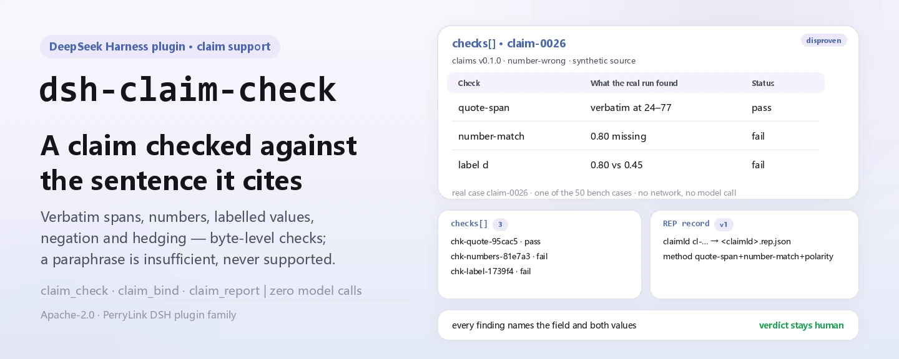
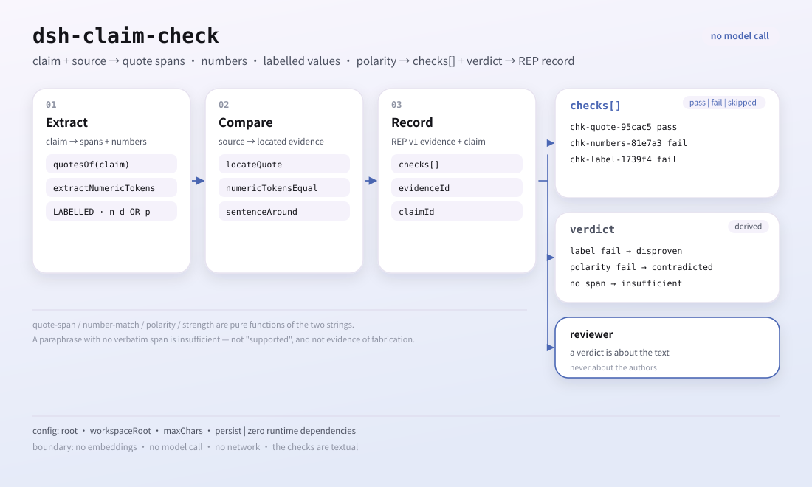
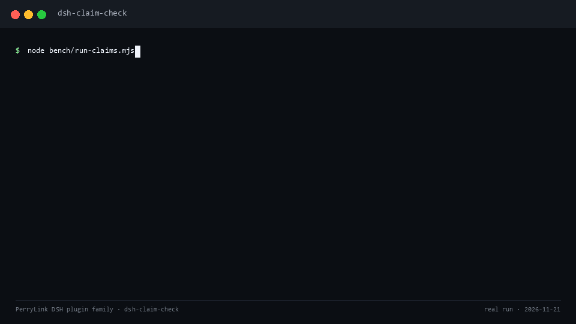

<div align="center">

<picture>
  <source media="(prefers-color-scheme: dark)" srcset="docs/assets/dsh-claim-check-hero-en-dark.webp">
  
</picture>

# dsh-claim-check

**A fonte realmente sustenta a afirmação como ela está escrita?**

*No nível de bytes, determinístico e recalculável: trechos literais, números, valores rotulados, negação e atenuação. Uma paráfrase é reportada como `insufficient` — nunca como "sustentada".*

[English](README.md) · [简体中文](README-zh.md) · [Español](README-es.md) · [Português](README-pt.md) · [हिन्दी](README-hi.md)

[](LICENSE)
[]()

</div>

---

## O que faz

- **Verificação de trecho literal** — todo trecho citado na afirmação deve ocorrer na fonte (espaços e Unicode normalizados).
- **Verificação de números** — todo literal numérico da afirmação deve ocorrer na fonte, com tolerância de formatação (`2.50` = `2.5`).
- **Verificação de valores rotulados** — quando a afirmação diz `d = 0.80` e a fonte diz `d = 0.45`, a afirmação é `disproven` e os dois valores são mostrados. É isso que transforma "falta um número" em uma contradição real.
- **Verificação de polaridade** — uma afirmação afirmativa construída sobre um trecho de uma oração negada ("**not** significant") é `contradicted`.
- **Verificação de força** — uma oração atenuada ou associativa ("may be associated", "preliminary") vendida como causal ("proves", "demonstrates") é `contradicted`.
- **Integração REP** — snapshot da fonte + afirmação + veredicto + verificações formam um registro válido; `claim_bind` verifica contra evidência já armazenada por `doc_anchor` / `cite_verify`.


<picture>
  <source media="(prefers-color-scheme: dark)" srcset="docs/assets/dsh-claim-check-flow-v5-dark.svg">
  
</picture>

*Estrutura: extrair → comparar → registrar; `checks[]` e `verdict` são as duas saídas, e uma paráfrase sem trecho literal é `insufficient` em vez de "sustentada". Os rótulos de token dentro do diagrama são os nomes reais das ferramentas e das verificações, então a mesma imagem serve aos cinco idiomas.*

## O que não faz

- **Sem semântica.** Uma paráfrase sem trecho literal é `insufficient`, não "sustentada". É um limite deliberado, não um bug.
- **Sem reanálise dos dados.** Não verifica se o estatístico subjacente está correto — isso é `dsh-statcheck`.
- **Sem leitura de PDF.** Extraia o texto primeiro (`dsh-doc-anchor`).
- **Sem acusações de má conduta.** Um veredicto fala do texto, nunca dos autores.
- **Sem chamada a modelo.** Cada achado é recalculável a partir das duas strings.

## Semântica dos veredictos

| Veredicto | Significado |
|---|---|
| `verified` | um trecho literal foi localizado **e** os números coincidem (e não há contradição de polaridade/força) |
| `disproven` | o trecho citado está ausente, ou um valor rotulado contradiz a fonte |
| `contradicted` | a negação ou a atenuação da oração citada foi invertida |
| `insufficient` | não há trecho literal (paráfrase), ou falta um número, ou a fonte não diz nada |
| `unverified` | reservado pela REP v1 para uma afirmação sem conteúdo verificável; a v0.1 reporta essa paráfrase como `insufficient` |

`insufficient` nunca significa falso, e nunca significa "limpo".

## Ferramentas

### `claim_check`

`{ claim, text? | path?, quote?, persist? }` → `{ ok, verdict, checks[], quotes[], labels[], evidenceId?, claimId?, recordPath? }`.

### `claim_bind`

`{ claim, evidenceId, quote?, persist? }` — lê o snapshot textual da evidência do armazenamento REP e grava ali a afirmação + o veredicto.

### `claim_report`

`{ claim, verdict, checks }` → `{ ok, markdown, sarif }`. Verificações com falha ou aviso viram resultados SARIF.

### Códigos de erro

`INVALID_INPUT` · `NOT_FOUND` · `PATH_ESCAPE` · `NOT_A_FILE` · `TOO_LARGE` · `EVIDENCE_UNKNOWN` · `STORE_ERROR`

## Compatibilidade e instalação

| | |
|---|---|
| DeepSeek Harness | **`dsh-v0.2.2-rc.4`** (verificado em 2026-11-18); peer `>=0.2.1-0 <0.3.0 \|\| >=0.2.2-0 <0.3.0` |
| Node | `^22.19.0 \|\| >=24.9.0` (testado em `24.22.1`), somente ESM |
| Peers | `@perrylink/dsh-research-core ^0.1.0`, `@deepseek-ai/cordis ^4.0.5-alpha.1`, `@deepseek-ai/dsh-tools`, `@deepseek-ai/schemastery ^3.18.5-alpha.1` |
| Dependências de runtime | **zero** |

```sh
dsh plugin --profile <name> add @perrylink/dsh-research-core @perrylink/dsh-claim-check
dsh --profile <name> --dump-config | grep @perrylink/dsh-claim-check
```

## Configuração

| Chave | Padrão | Significado |
|---|---|---|
| `enabled` | `true` | `false` não monta nada |
| `root` | `.claim-check` | raiz do armazenamento e dos registros |
| `workspaceRoot` | `process.cwd()` | os caminhos das fontes devem resolver dentro dela |
| `maxChars` | `2000000` | limite de caracteres da fonte (falha, nunca trunca) |
| `persist` | `true` | armazena evidência + afirmação + registro |

## Avaliação



*Animado: `node bench/run-claims.mjs` sobre o conjunto congelado `dsh-research-bench` claims v0.1.0 (o checkout de bench irmão é indicado por `BENCH_DIR`; sem rede, sem chamada a modelo; reexecutado em 2026-11-21). São números de linha de base de regressão, não uma estimativa não enviesada — a seção do conjunto retido abaixo reporta 0.96.*


### Linha de base de regressão — `dsh-research-bench` claims v0.1.0 (50 casos)

```sh
pnpm run bench:claims
```

| métrica | valor |
|---|---:|
| acurácia do veredicto | **1.00** |
| precision / recall de verified | **1.00 / 1.00** |
| precision / recall de insufficient | **1.00 / 1.00** |
| precision / recall de contradicted | **1.00 / 1.00** |
| precision / recall de disproven | **1.00 / 1.00** |
| taxa de sobreafirmação (não sustentado chamado de verified) | **0.00** |
| taxa de falsos alarmes em afirmações sustentadas | **0.00** |

Predições por caso em bruto: [`bench/results-claims.json`](bench/results-claims.json).

**Ressalva de validade (leia antes de citar os números).** Os 50 casos e as regras do detector foram escritos juntos a partir da mesma rubrica, e a regra de polaridade foi estreitada depois que um caso sustentado falhou durante o desenvolvimento. Esses números são uma **linha de base de regressão, não uma estimativa não enviesada** da acurácia em manuscritos reais. O conjunto retido abaixo é o próximo passo; é um hold-out temporal do mesmo autor, não uma auditoria externa totalmente cega.

### Conjunto retido — `dsh-research-bench` claims-heldout v0.1.0 (50 casos, congelados em 2026-11-08)

```sh
pnpm run bench:claims-holdout
```

Os 50 casos vivem na árvore de trabalho irmã `dsh-research-bench`, em `data/claims-heldout/` (sete fontes sintéticas, quatro orações cada) e foram congelados antes da primeira execução de avaliação. `SUMMARY.json` registra `heldOut: true`, `frozenAt: "2026-11-08"` e `sha256:016eaa67ba12ec1b3022e68dbc627b414c43733551fdd457b70dd1907e81d470`. O runner recalcula o hash de `cases.jsonl` em cada execução e se recusa a pontuar se o hash congelado não coincidir mais; nenhum rótulo foi alterado depois do congelamento.

| métrica | linha de base de regressão | conjunto retido |
|---|---:|---:|
| acurácia do veredicto | 1.00 | **0.96** (48/50) |
| precision / recall de verified | 1.00 / 1.00 | **0.88 / 1.00** |
| precision / recall de insufficient | 1.00 / 1.00 | **1.00 / 1.00** |
| precision / recall de contradicted | 1.00 / 1.00 | **1.00 / 0.83** |
| precision / recall de disproven | 1.00 / 1.00 | **1.00 / 1.00** |
| taxa de sobreafirmação (não sustentado chamado de verified) | 0.00 | **0.06** (2/35) |
| taxa de falsos alarmes em afirmações sustentadas | 0.00 | **0.00** |

Acurácia por categoria: supported 15/15, paraphrase 10/10, number-wrong 8/8, negated 6/7, quote-mined 4/5, insufficient 5/5.

Predições por caso em bruto: [`bench/results-claims-holdout.json`](bench/results-claims-holdout.json); markdown: [`bench/results-claims-holdout.md`](bench/results-claims-holdout.md).

**Os dois erros são sobreafirmações, e ambos são lacunas de cobertura da lista de sinais.** A localização de citações, a correspondência de números e a contradição de valores rotulados foram perfeitas neste conjunto; os erros são sinais semânticos que as listas léxicas não conhecem:

1. `claim-0034` (negated; esperava-se `contradicted`, previu-se `verified`). A fonte diz "The coating failed to improve rate capability..." e a afirmação cita apenas "improve rate capability at 4.2 V". "Failed to" é uma negação semântica, mas os sinais de negação da v0.1 são `not` / `no` / `never` / ... e não o incluem, então a verificação de polaridade nunca roda. Correção candidata: adicionar `fail(?:ed|s)? to`, `unable to` e `declined to` à lista de sinais, com testes de regressão.
2. `claim-0045` (quote-mined; esperava-se `contradicted`, previu-se `verified`). A fonte diz "Cooling seems tied to canopy density..." e a afirmação diz que "prova" um efeito causal. "Seems tied to" é associativo/atenuado, mas os sinais de atenuação da v0.1 não o incluem, então a verificação de força nunca roda. Correção candidata: adicionar `seem(?:s|ed)?`, `appear(?:s|ed)?`, `tied to`, `linked to`, `tentative` e `exploratory` aos sinais de atenuação, com testes.

Esses são exatamente os casos que uma linha de base de regressão não consegue expor: o mesmo autor escreveu os casos da base junto com as listas de sinais.

**Independência (honesta).** O conjunto retido **não é uma auditoria externa totalmente cega**. Foi escrito pelo mesmo autor da rubrica da linha de base de regressão, a partir de `rubric/CLAIMS.md`, e segue as mesmas convenções de construção (trechos explícitos entre aspas duplas, um trecho citado por afirmação, parágrafos sintéticos em inglês). O que é independente é o conteúdo: sete tópicos novos, orações novas, números novos, e nenhum parágrafo de origem ou afirmação reutilizados de `data/claims`; os rótulos foram fixados e hasheados antes da primeira execução de avaliação, e nenhum rótulo foi alterado depois. É um hold-out temporal e um teste de cobertura da lista de sinais, não uma estimativa não enviesada da acurácia em manuscritos reais: o conjunto é sintético e pequeno (5–15 casos por categoria). O conjunto de dados permanece por enquanto na árvore de trabalho irmã de bench; este repositório versiona o runner e os resultados congelados, não os casos.

### Testes

**26 testes** em três arquivos: evaluator (extração de citações incl. possessivos, offsets exatos quando o primeiro token se repete, localização da oração, verified / paráfrase / citação ausente / contradição de valor rotulado / inversão de negação / sobreafirmação atenuada / acurácia de resultado nulo / citações de intervalo / número ausente / conteúdo ausente), runtime/tools (validade do registro REP, reverificação sem conflito de evidência, persist=false, escape de caminho, bind à evidência armazenada e ao seu snapshot textual em vez do primeiro snapshot; esquemas, renderizadores, ramo de falha, contrato do pacote), mount (o contrato de montagem habilitado/desabilitado).

## Limitações conhecidas (v0.1)

- Citação indireta, marcadores de citação e consultas a tabelas não são analisados.
- A detecção de atenuação é léxica (uma lista fixa de sinais), então uma afirmação causal que evite esses verbos pode passar.
- Um *intervalo* citado ou tamanho de amostra não carrega direção, então a polaridade só é verificada em trechos direcionais.
- Afirmações em outros idiomas são suportadas estruturalmente, mas as listas de sinais são apenas em inglês.
- A execução retida encontrou duas lacunas concretas de sinais: `failed to` (negação semântica) e `seems tied to` (atenuação); ambas são acompanhadas na seção do conjunto retido acima.

## Licença

Apache-2.0. Sem código de terceiros em runtime.
